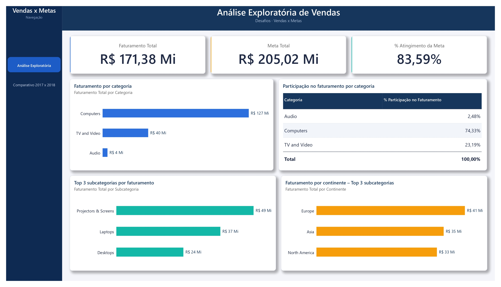
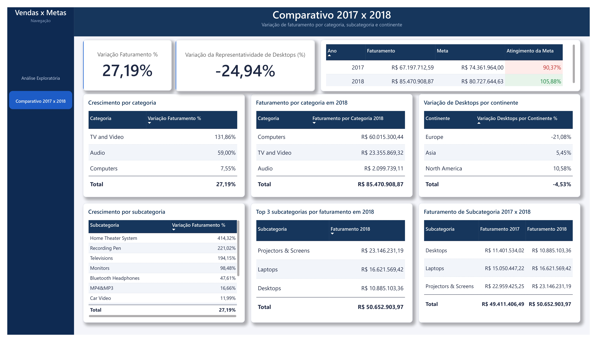

# Projeto Vendas x Metas — Power BI

## 1. Sobre o projeto

Este projeto foi desenvolvido para atender ao desafio **Vendas x Metas**, cujo objetivo é construir um dashboard capaz de analisar a evolução do faturamento, compará-lo com as metas comerciais e apresentar uma visão comparativa entre 2017 e 2018.

A base disponibilizada pelo desafio contém registros de **01/01/2017 a 16/03/2019**. As análises buscam apoiar a avaliação do desempenho comercial, a revisão das projeções de faturamento e, quando necessário, o recálculo das metas de 2019.

O relatório foi organizado em duas páginas:

1. **Análise Exploratória de Vendas** — visão geral do faturamento, metas, participação das categorias, principais subcategorias e distribuição geográfica.
2. **Comparativo 2017 x 2018** — evolução do faturamento, comparação entre faturamento e metas anuais, desempenho por categoria e subcategoria, representatividade de Desktops e variação por continente.

## 2. Objetivos de negócio

O relatório foi construído para responder aos dois grupos de perguntas propostos no desafio:

- **Análise exploratória:** entender o resultado consolidado do período e identificar onde o faturamento está concentrado.
- **Análise comparativa:** avaliar o desempenho de 2018 em relação a 2017, localizar crescimentos e quedas e verificar o cumprimento das metas comerciais.

## 3. Ferramentas utilizadas

- **Microsoft Power BI Desktop** — modelagem, medidas e desenvolvimento dos dashboards.
- **Power Query** — extração, limpeza e transformação dos dados.
- **Linguagem M** — etapas de transformação no Power Query.
- **DAX** — criação de medidas e cálculos analíticos.
- **GitHub** — versionamento e publicação do projeto.

## 4. Fontes de dados e estrutura

As principais tabelas utilizadas no modelo foram:

| Tabela | Conteúdo e finalidade |
|---|---|
| `Vendas` | Registros das transações comerciais, datas, produto, cliente, quantidade, preços, custos e descontos. |
| `Cliente` | Dados cadastrais e identificadores dos clientes. |
| `Produto` | Cadastro de produtos, marcas e identificadores de subcategoria. |
| `Subcategoria` | Classificação dos produtos em subcategorias e categorias. |
| `Localizacao` | Informações geográficas de cidade, estado/província e país, além da classificação de continente. |
| `Metas` | Metas organizadas por categoria, continente e ano. |
| `DimAno` | Dimensão auxiliar para análise temporal. |
| `DimCategoria` | Dimensão auxiliar para padronizar a análise por categoria. |
| `DimContinente` | Dimensão auxiliar para padronizar a análise por continente. |

As dimensões auxiliares permitem centralizar atributos utilizados como filtros e compartilhá-los entre as tabelas relacionadas de vendas e metas.

## 5. Preparação e transformação dos dados — Power Query

A etapa de ETL foi realizada no Power Query. O trabalho incluiu inspeção das tabelas, padronização de tipos, limpeza de registros e criação de campos necessários às análises.

### 5.1. Tabela `Vendas`

Foram criadas três colunas personalizadas:

**Valor Venda**

Calcula o valor efetivo da venda após o desconto:

```text
Valor Venda = (Preço Unitário × Quantidade) - Valor Desconto
```

**Valor Custo**

Calcula o custo total dos itens vendidos:

```text
Valor Custo = Custo Unitário × Quantidade
```

**Lucro Bruto**

Calcula a diferença entre o valor da venda e o custo:

```text
Lucro Bruto = Valor Venda - Valor Custo
```

### 5.2. Tabela `Cliente`

Foram realizadas verificações de qualidade, incluindo unicidade do identificador do cliente, preenchimento dos campos importantes, identificação da cidade e análise dos campos cadastrais.

Os nomes de empresa vazios foram considerados esperados para registros de clientes do tipo pessoa física.

### 5.3. Tabelas `Produto` e `Subcategoria`

Foram conferidos os identificadores dos produtos e das subcategorias, a presença dos nomes de produtos e marcas e a consistência da classificação.

Essa estrutura permite analisar os dados em diferentes níveis: produto, subcategoria e categoria.

### 5.4. Tabela `Localizacao`

A fonte de localização continha registros em diferentes níveis geográficos, como cidade, estado/província e país/região.

No tratamento, foram realizadas operações de remoção de linhas que não representavam registros, exclusão de registros completamente vazios e conferência dos campos geográficos.

Após a limpeza, a consulta ficou com **671 registros**.

Foi criada a coluna `Continente`, utilizando o país como referência e respeitando a classificação fornecida pela empresa. A função `Text.Trim()` foi utilizada para remover espaços excedentes dos nomes dos países antes da comparação, evitando falhas de correspondência.

### 5.5. Tabela `Metas`

O arquivo de metas estava dividido em três planilhas: 2017, 2018 e 2019. Os continentes estavam organizados em colunas.

Para padronizar a estrutura, foi utilizada a transformação **Unpivot**, convertendo as colunas dos continentes em linhas. Em seguida:

1. A primeira coluna foi identificada como `Categoria`.
2. A linha de total foi removida.
3. As colunas dos continentes foram transformadas em registros.
4. A coluna `Atributo` foi renomeada para `Continente`.
5. A coluna de valores foi padronizada como `Meta`.
6. Foi criada a coluna `Ano` para identificar a planilha de origem.
7. As três consultas anuais foram combinadas por meio de Acrescentar Consultas (Append Queries).

O resultado foi uma tabela `Metas` consolidada com **27 registros**, correspondentes a três categorias, três continentes e três anos.

## 6. Modelagem de dados

O modelo utiliza tabelas de fatos e dimensões.

- `Vendas` e `Metas` armazenam os valores que serão analisados.
- `DimAno`, `DimCategoria` e `DimContinente` centralizam atributos utilizados para filtrar e organizar as análises.
- As tabelas `Cliente`, `Produto`, `Subcategoria` e `Localizacao` complementam a classificação dos registros.

As dimensões permitem utilizar um mesmo critério de filtro em tabelas relacionadas. Por exemplo, a dimensão de categoria pode servir como referência para analisar tanto o faturamento quanto as metas por categoria.

O relacionamento entre `Subcategoria` e `Vendas` foi mantido inativo para evitar caminhos ambíguos, pois já existe um caminho ativo entre essas tabelas por meio de `Produto`.

## 7. Medidas e cálculos — DAX

As medidas foram desenvolvidas para responder às perguntas do desafio. Entre os indicadores utilizados estão:

- Faturamento Total;
- Meta Total;
- Atingimento da Meta %;
- Participação no Faturamento;
- Variação do Faturamento %;
- Faturamento por categoria e subcategoria;
- Variação por categoria, subcategoria e continente;
- Faturamento e metas por ano.

A medida de atingimento da meta utiliza a divisão do faturamento total pela meta total:

```dax
Atingimento da Meta % =
DIVIDE(
    [Faturamento Total],
    [Meta Total],
    0
)
```

As medidas respondem aos filtros aplicados no relatório, permitindo analisar os resultados por ano, categoria e continente, conforme os relacionamentos do modelo.

## 8. Páginas do relatório

### 8.1. Análise Exploratória de Vendas



A primeira página apresenta a visão consolidada do período:

| Indicador | Resultado |
|---|---:|
| Faturamento total | R$ 171,38 milhões |
| Meta total | R$ 205,02 milhões |
| Atingimento da meta | 83,59% |
| Categoria de maior faturamento | Computers |
| Participação de Computers | 74,33% |

Os visuais apresentam:

- Faturamento por categoria;
- Participação percentual das categorias no faturamento;
- Top 3 subcategorias por faturamento;
- Faturamento por continente considerando as três principais subcategorias.

### 8.2. Comparativo 2017 x 2018



A segunda página apresenta a evolução do faturamento e o desempenho comercial entre 2017 e 2018.

#### Comparação de faturamento e metas

| Ano | Faturamento | Meta | Atingimento |
|---|---:|---:|---:|
| 2017 | R$ 67.197.712,59 | R$ 74.361.964,00 | 90,37% |
| 2018 | R$ 85.470.908,87 | R$ 80.727.644,63 | 105,88% |

Em 2017, a empresa atingiu 90,37% da meta estabelecida. Em 2018, superou a meta, alcançando 105,88% de atingimento.

#### Outros indicadores comparativos

| Indicador | Resultado |
|---|---:|
| Variação do faturamento entre 2017 e 2018 | +27,19% |
| Variação da representatividade de Desktops | -24,94% |
| Variação de Desktops na Europa | -21,08% |
| Maior crescimento por categoria | TV and Video — +131,86% |

A página também apresenta o crescimento por categoria e subcategoria, a variação de Desktops por continente, o faturamento por categoria em 2018 e o Top 3 de subcategorias daquele ano.

## 9. Respostas às 15 perguntas do desafio

### Análise exploratória

**1. Qual foi o faturamento total no período?**

R$ 171,38 milhões.

**2. Qual foi a meta total no período?**

R$ 205,02 milhões.

**3. Qual foi o percentual de atingimento da meta?**

83,59%.

**4. Qual categoria apresentou o maior faturamento?**

Computers.

**5. Qual foi a participação dessa categoria no faturamento total?**

74,33%.

**6. Quais foram as três subcategorias com maior faturamento?**

- Projectors & Screens;
- Laptops;
- Desktops.

**7. Como se distribuiu o faturamento por continente considerando essas três subcategorias?**

O relatório apresenta o faturamento por continente com o filtro Top 3 subcategorias aplicado.

### Comparativo entre 2017 e 2018

**8. Qual foi a variação do faturamento entre 2017 e 2018?**

Crescimento de 27,19%.

**9. Todas as subcategorias apresentaram variação positiva?**

Não. Desktops apresentou variação negativa de 4,53%. As demais subcategorias apresentaram variações positivas.

**10. Como variou a representatividade de Desktops entre os anos?**

A variação da representatividade foi de -24,94%.

**11. Qual continente foi responsável pela queda de faturamento de Desktops?**

Europe, com variação de -21,08%.

**12. Qual categoria apresentou o maior faturamento em 2018 e qual foi o valor?**

Computers, com R$ 60.015.300,44.

**13. Qual categoria apresentou o maior crescimento percentual entre 2017 e 2018?**

TV and Video, com crescimento de 131,86%.

**14. Quais foram as três subcategorias com maior faturamento em 2018?**

- Projectors & Screens — R$ 23.146.231,19;
- Laptops — R$ 16.621.569,42;
- Desktops — R$ 10.885.103,36.

**15. As três principais subcategorias de 2018 são as mesmas do período completo?**

Sim. Projectors & Screens, Laptops e Desktops aparecem nas duas classificações.

## 10. Principais insights

- O faturamento consolidado do período foi de R$ 171,38 milhões, equivalente a 83,59% da meta total.
- Computers concentrou 74,33% do faturamento.
- O faturamento cresceu 27,19% entre 2017 e 2018.
- Em 2017, a empresa ficou abaixo da meta; em 2018, superou o valor planejado.
- TV and Video apresentou o maior crescimento percentual entre as categorias, com 131,86%.
- Desktops foi a subcategoria com retração no comparativo apresentado, com queda de 4,53%.
- A Europa apresentou a maior contribuição negativa na variação de faturamento de Desktops, com -21,08%.
- O Top 3 de subcategorias permaneceu igual na análise do período completo e no ano de 2018.

**Observação sobre 2019:** a base de vendas termina em 16/03/2019. Portanto, o atingimento de 37,47% observado para 2019 é parcial e não deve ser interpretado como resultado anual definitivo.

## 11. Estrutura do repositório

```text
desafio-metas-vendas/
│
├── README.md
├── desafio-metas-vendas-final.pbix
├── dashboard-analise-exploratoria.jpg
└── dashboard-comparativo-2017-2018.jpg
```

## 12. Como visualizar o projeto

1. Baixe o arquivo `desafio-metas-vendas-final.pbix` deste repositório.
2. Abra o arquivo no Microsoft Power BI Desktop.
3. Navegue entre as páginas **Análise Exploratória de Vendas** e **Comparativo 2017 x 2018**.

## 13. Considerações finais

O projeto permitiu transformar diferentes fontes de dados em um relatório integrado para análise de faturamento, metas e desempenho comercial.

Além da construção dos dashboards, foram aplicados conhecimentos de tratamento de dados, Power Query, linguagem M, modelagem dimensional, relacionamentos e medidas DAX.

O resultado oferece uma visão consolidada do desempenho comercial e permite identificar tanto os segmentos de maior contribuição quanto aqueles que merecem atenção na revisão do planejamento.
